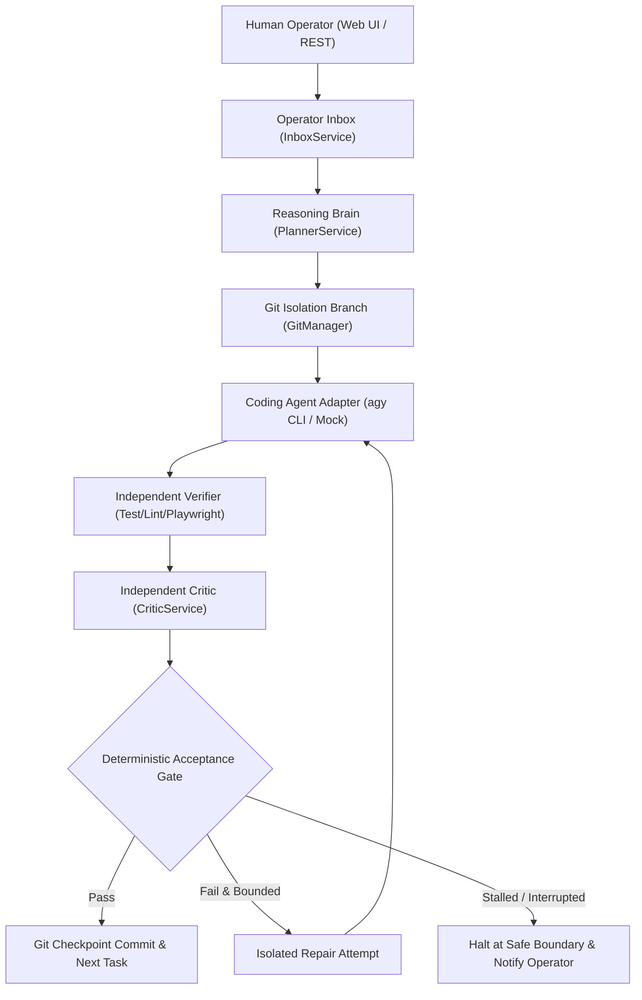

# Autonomous Development Orchestrator (MVP)

A local-first application that coordinates a **project reasoning brain** and a **coding agent** in a verifiable, bounded, and human-steerable autonomous development loop.

---

## Authoritative Specification & Verification

This system is built strictly against `Autonomous_Development_Orchestrator_MVP_Blueprint_FINAL.md`. Every milestone from Milestone 0 through Milestone 7 has been executed incrementally with real tests, SQLite persistence, and zero fake mocks in production paths.

### Milestones Implemented & Tested

- **Milestone 0: Repository Foundation** — Monorepo (npm workspaces), Fastify backend binding strictly to `127.0.0.1:4317`, React Vite dashboard shell, TypeScript strict mode, baseline Playwright smoke test.
- **Milestone 1: Persistence & Bare Control Dashboard** — SQLite with native Node.js v24 `DatabaseSync` engine in WAL mode, 14 relational tables, sequence-numbered durable `EventStore`, Server-Sent Events (SSE), and `RunStateMachine`.
- **Milestone 2: Providers & Coding-Agent Adapters** — Normalized `ReasoningRegistry`, `OpenAIProvider`, `OpenAICompatibleLocalProvider` (strict Local-Only enforcement, no silent cloud fallback), official `AntigravityAdapter` (`agy` CLI headless runner), `MockAgentAdapter`, and pre-flight `BudgetService`.
- **Milestone 3: Mandatory Feasibility Gate (Vertical Slice)** — Proven autonomous pipeline: isolated git branches (`attempt-<n>`), fresh Executor packets, independent lint/test runner, `BrowserVerifier` (Playwright at 1440x900 and 390x844 viewports), independent `CriticService`, deterministic `AcceptanceGate`, and automated Git checkpoint commits.
- **Milestone 4: Reliability, Stagnation & Context Compaction** — `StagnationDetector` (empty diffs, identical error hashes, ping-pong oscillations), `MemoryManager` (`TASK_HISTORY.json`, `CURRENT_STATE.md`, `REPO_MAP.md`), and process tree supervisor with clean signal shutdown.
- **Milestone 5: Project Wizard & Blueprint Import** — 6-step interactive wizard in React, multi-format `BlueprintImporter` (.md, .txt, .json, .yaml, .pdf, .docx), `RequirementExtractor` with provenance citation, and contradiction engine.
- **Milestone 6: Human Direction & Task Inspector** — Operator inbox (`InboxService`) supporting guidance, replan, safe interrupt, priority overrides, and prompt context steering. Rich React `TaskInspector` modal displaying real verifier exit codes, dual-viewport screenshot gallery, and Critic reviews.
- **Milestone 7: Advanced UI, Export & Security Hardening** — Full project export bundle (`GET /api/v1/projects/:projectId/export` in JSON or Markdown), `SecretRedactor` (sanitizing tokens, passwords, and private keys), searchable event stream with category filters, and loopback CORS enforcement.

---

## System Architecture



---

## Prerequisites

- **Node.js:** v24.x or v20.x Active LTS
- **Git:** 2.30+
- **Browser Automation:** Chromium (installed automatically by Playwright)
- **Optional Local LLM:** Ollama / llama.cpp / vLLM running on `http://127.0.0.1:11434` for 100% local reasoning
- **Optional Coding Agent:** Google Antigravity CLI (`agy`) installed and authenticated

---

## Quick Start

### 1. Install Dependencies
```bash
npm install
```

### 2. Run Comprehensive Test Suite (38 Vitest Tests)
```bash
npm test
```

### 3. Run Playwright End-to-End Browser Tests
```bash
npx playwright test
```

### 4. Build Monorepo (Packages, Server & Web UI)
```bash
npm run build
```

### 5. Start Development Servers
```bash
# Start Fastify backend on 127.0.0.1:4317
npm run dev --workspace=apps/server

# Start Vite dashboard on 127.0.0.1:5173
npm run dev --workspace=apps/web
```

---

## Key REST API Endpoints

| Method | Endpoint | Description |
|---|---|---|
| `GET` | `/api/v1/health` | Health probe, loopback binding status, Node.js version |
| `GET` | `/api/v1/projects` | List projects |
| `POST` | `/api/v1/projects` | Create or configure a project |
| `GET` | `/api/v1/projects/:projectId/export` | Export sanitized memory, tasks, and audit log (JSON or Markdown) |
| `GET` | `/api/v1/projects/:projectId/events` | Durable SSE real-time event stream |
| `POST` | `/api/v1/projects/:projectId/messages` | Send operator direction (guidance, replan, safe interrupt) |
| `GET` | `/api/v1/projects/:projectId/messages` | List project messages |
| `POST` | `/api/v1/messages/:messageId/cancel` | Cancel a pending direction |
| `GET` | `/api/v1/projects/:projectId/tasks` | List tasks with attempt counts and latest status |
| `GET` | `/api/v1/tasks/:taskId` | Detailed task inspection (verifications, screenshots, critic reviews) |
| `GET` | `/api/v1/artifacts/:filename` | Dual-viewport Playwright screenshot artifacts |
| `POST` | `/api/v1/projects/:projectId/blueprints` | Import specification document (.md, .txt, .json, .pdf, etc.) |
| `POST` | `/api/v1/projects/:projectId/runs` | Start or resume an autonomous run |
| `POST` | `/api/v1/runs/:runId/pause` | Pause run at the current attempt boundary |
| `POST` | `/api/v1/runs/:runId/stop` | Halt run dispatch immediately |

---

## Security & Privacy Policies

- **Strict Loopback Binding:** The server binds solely to `127.0.0.1:4317`. CORS origin verification rejects external domains and non-loopback clients.
- **Local-Only Policy:** When configured for local reasoning, automatic cloud fallback is strictly forbidden.
- **Honest Classification:** Hybrid configurations (local reasoning + remote Antigravity coding agent) are explicitly labeled as **Hybrid (Not End-to-End Offline)**.
- **Secret Redaction:** `SecretRedactor` automatically filters API tokens, passwords, and private keys before rendering exports or persisting event payloads.
- **Finite Budgets:** Dispatches are guarded by pre-flight budget reservations with a $0.50 warning threshold, $2.00 task ceiling, and $10.00 run ceiling.
