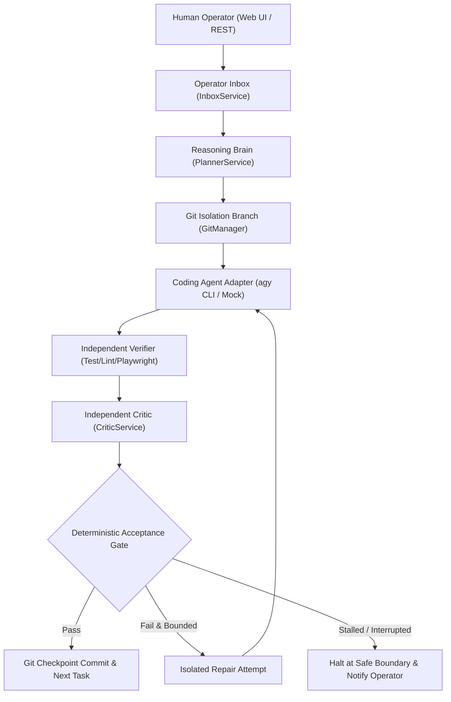

# Autonomous Development Orchestrator (MVP)

A local-first application that coordinates a **project reasoning brain** and a **coding agent** in a verifiable, bounded, and human-steerable autonomous development loop.

---

## Authoritative Specification & Verification

This system is built strictly against `Autonomous_Development_Orchestrator_MVP_Blueprint_FINAL.md`. Every milestone from Milestone 0 through Milestone 7 has been executed incrementally with real tests, SQLite persistence, and zero fake mocks in production paths.

### Milestones Implemented & Tested

- **Milestone 0: Repository Foundation** — Monorepo (npm workspaces), Fastify backend binding strictly to `127.0.0.1:4317`, React Vite dashboard shell, TypeScript strict mode, baseline Playwright smoke test.
- **Milestone 1: Persistence & Bare Control Dashboard** — SQLite with native Node.js v24 `DatabaseSync` engine in WAL mode, 14 relational tables, sequence-numbered durable `EventStore`, Server-Sent Events (SSE), and `RunStateMachine`.
- **Milestone 2: Providers & Coding-Agent Adapters** — Normalized `ReasoningRegistry`, `OpenAIProvider`, `OpenAICompatibleLocalProvider` (strict Local-Only enforcement, no silent cloud fallback), official `AntigravityAdapter` (`agy` CLI headless runner), `MockAgentAdapter`, and pre-flight `BudgetService`.
- **Milestone 3: Mandatory Feasibility Gate (Vertical Slice)** — Proven autonomous pipeline: isolated git branches (`attempt-<n>`), fresh Executor packets, independent lint/test runner, `BrowserVerifier` (Playwright at 1440x900 and 390x844 viewports), independent `CriticService`, deterministic `AcceptanceGate`, and automated Git checkpoint commits.
- **Milestone 4: Reliability, Stagnation & Context Compaction** — `StagnationDetector` (empty diffs, identical error hashes, ping-pong oscillations), `MemoryManager` (`TASK_HISTORY.json`, `CURRENT_STATE.md`, `REPO_MAP.md`), and process tree supervisor with clean signal shutdown.
- **Milestone 5: Project Wizard & Blueprint Import** — 6-step interactive wizard in React, multi-format `BlueprintImporter` (.md, .txt, .json, .yaml, .pdf, .docx), `RequirementExtractor` with provenance citation, and contradiction engine.
- **Milestone 6: Human Direction & Task Inspector** — Operator inbox (`InboxService`) supporting guidance, replan, safe interrupt, priority overrides, and prompt context steering. Rich React `TaskInspector` modal displaying real verifier exit codes, dual-viewport screenshot gallery, and Critic reviews.
- **Milestone 7: Advanced UI, Export & Security Hardening** — Full project export bundle (`GET /api/v1/projects/:projectId/export` in JSON or Markdown), `SecretRedactor` (sanitizing tokens, passwords, and private keys), searchable event stream with category filters, and loopback CORS enforcement.

---

## System Architecture



---

## Prerequisites

- **Node.js:** v24.x or v20.x Active LTS
- **Git:** 2.30+
- **Browser Automation:** Chromium (installed automatically by Playwright)
- **Optional Local LLM:** Ollama / llama.cpp / vLLM running on `http://127.0.0.1:11434` for 100% local reasoning
- **Optional Coding Agent:** Google Antigravity CLI (`agy`) installed and authenticated

---

## Quick Start

### 1. Install Dependencies
```bash
npm install
```

### 2. Run Comprehensive Test Suite (51 Vitest Tests)
```bash
npm test
```

### 3. Run Playwright End-to-End Multi-Viewport Browser Tests
```bash
npx playwright test
```

### 4. Build Monorepo (Packages, Server & Web UI)
```bash
npm run build
```

### 5. Production Startup Workflow
```bash
# Start backend server in production mode
npm start --workspace=apps/server

# Web dashboard is built into apps/web/dist and served statically
```

### 6. Development Startup Workflow
```bash
# Start Fastify backend on 127.0.0.1:4317
npm run dev --workspace=apps/server

# Start Vite dashboard on 127.0.0.1:5173
npm run dev --workspace=apps/web
```

---

## Explicit Reasoning Engine Selection: OpenAI API vs Local Ollama

The dashboard features an always-visible top-bar segmented controller:
```
[ ☁️ OpenAI API ]  [ 🦙 Local Ollama ]  • Live Status Pill ⚙️
```

### Capabilities & Guarantees
1. **Instant Switching:** Clicking between OpenAI API and Local Ollama instantly validates configuration and updates the active backend registry without page reloads.
2. **Honest Live Status Badges:** Status pills are backed by real HTTP probes (`/api/v1/providers/reasoning/probe-local`), truthfully distinguishing:
   - `Local Ollama · Connected (<latency>ms)`
   - `Local Ollama · Model unavailable`
   - `Local Ollama · Server not running`
   - `Local Ollama · Testing connection`
   - `OpenAI API · Key configured`
   - `OpenAI API · Key required`
3. **No Silent Fallback:** Local Ollama strictly forbids silent cloud fallback. If Ollama is offline or uninstalled, the loop halts and reports the failure honestly.
4. **Cold-Start Allowance:** Configurable cold-start timeouts up to 300 seconds (5 minutes) allow heavy model weights to load onto GPU/VRAM before reasoning dispatches timeout.
5. **Secret Protection:** API keys are stored solely in local application settings, masked on return (`sk-proj-••••...1234`), and never committed to source trees or project `.env` files.

---

## Key REST API Endpoints

| Method | Endpoint | Description |
|---|---|---|
| `GET` | `/api/v1/health` | Health probe, loopback binding status, Node.js version |
| `GET` | `/api/v1/projects` | List projects |
| `POST` | `/api/v1/projects` | Create or configure a project |
| `GET` | `/api/v1/projects/:projectId/export` | Export sanitized memory, tasks, and audit log (JSON or Markdown) |
| `GET` | `/api/v1/projects/:projectId/events` | Durable SSE real-time event stream |
| `POST` | `/api/v1/projects/:projectId/messages` | Send operator direction (guidance, replan, safe interrupt) |
| `GET` | `/api/v1/projects/:projectId/messages` | List project messages |
| `POST` | `/api/v1/messages/:messageId/cancel` | Cancel a pending direction |
| `GET` | `/api/v1/projects/:projectId/tasks` | List tasks with attempt counts and latest status |
| `GET` | `/api/v1/tasks/:taskId` | Detailed task inspection (verifications, screenshots, critic reviews) |
| `GET` | `/api/v1/artifacts/:filename` | Dual-viewport Playwright screenshot artifacts |
| `POST` | `/api/v1/projects/:projectId/blueprints` | Import specification document (.md, .txt, .json, .pdf, etc.) |
| `POST` | `/api/v1/projects/:projectId/runs` | Start or resume an autonomous run |
| `POST` | `/api/v1/runs/:runId/pause` | Pause run at the current attempt boundary |
| `POST` | `/api/v1/runs/:runId/stop` | Halt run dispatch immediately |
| `GET` | `/api/v1/providers/reasoning` | Active reasoning provider (Ollama / OpenAI Cloud) |
| `POST` | `/api/v1/providers/reasoning/select` | Toggle active reasoning engine |
| `GET` | `/api/v1/ide/status` | Current IDE connection status, detected workspaces, and stages |
| `POST` | `/api/v1/ide/detect` | Rescan running IDE processes and storage workspaces |
| `POST` | `/api/v1/ide/select-workspace` | Select specific IDE workspace from detected windows |
| `POST` | `/api/v1/ide/connect` | Run 6-stage visible IDE verification handshake |
| `POST` | `/api/v1/ide/test-connection` | Run agent readiness and probe response test |
| `POST` | `/api/v1/ide/disconnect` | Detach active IDE session |
| `POST` | `/api/v1/ide/mode` | Switch mode between `visible_ide` and `headless_cli` |

---

## Visible Antigravity IDE Integration

The orchestrator integrates directly with your **normal, visible Antigravity IDE** window so you can watch code changes in real time inside the editor while the orchestrator automatically plans tasks, runs independent verification tests, and synchronizes the development loop.

### 6-Stage Verified Connection Pipeline
Before autonomous task dispatch is permitted, the orchestrator enforces a strict visible verification workflow:

```
[1] IDE Detected ➔ [2] Workspace Identified ➔ [3] Connection Established ➔ [4] Workspace Confirmed ➔ [5] Agent Tested ➔ [6] Ready
```

1. **IDE Detected**: Queries running processes (`Antigravity IDE.exe`, `language_server_windows_x64.exe`) and extracts process IDs.
2. **Workspace Identified**: Parses official VS Code workspace state (`storage.json` and `workspaceStorage`) to discover all open and recent windows.
3. **Connection Established**: Connects to the native `agentapi` / language server communication channel and confirms responsiveness.
4. **Workspace Confirmed**: Compares canonical filesystem paths (`fs.realpathSync`) against the active project's root. Mismatches are rejected with an explicit error to prevent accidental execution in the wrong project.
5. **Agent Tested**: Executes an agent readiness handshake probe and verifies bidirectional communication.
6. **Ready**: Authorizes the autonomous development loop and begins periodic heartbeat monitoring.

### Execution Modes
- **Visible Antigravity IDE (Native Editor)**: Changes appear live in the open editor canvas as the agent works.
- **Headless CLI (`agy`)**: Alternative background mode running via standard CLI execution.

### Git & Non-Git Workspace Safety Guard
To protect unrelated human work:
- Before any task dispatch, the orchestrator inspects workspace state.
- In Git repositories, it inspects `git status --porcelain`. In non-Git folders, it scans file hashes against `.orchestrator/snapshots`.
- If uncommitted or untracked changes exist that were made manually, the loop safely pauses with a `run.dirty_workspace` event unless explicitly allowed.
- It **never** discards, overwrites, or reverts unrelated developer work.

---

## Optional Git Support & Non-Git Local Snapshot Safety

The Autonomous Development Orchestrator treats Git and GitHub integration as **entirely optional**:

1. **GitHub is Never Required:**
   - No GitHub account, remote repository, or internet connection is needed to create projects or run autonomous development loops.
   - Repositories without remotes function 100% offline.

2. **Universal Local Directory Support:**
   - Any valid local filesystem directory can be orchestrated, including directories without a `.git` folder.

3. **Dual Safety Mechanisms:**
   - **When Git is Available:** Employs isolated branches (`orchestrator/<project>/<task>/attempt-<n>`) and deterministic checkpoint commits (`chore(orchestrator): checkpoint task ...`).
   - **When Git is Unavailable (Local Snapshot Mode):** Activates `SnapshotManager`. Takes durable file snapshots in `.orchestrator/snapshots/<id>/files` with a cryptographic `manifest.json`. Computes unified diffs directly without Git CLI. Failed attempts roll back strictly the attempt-modified and newly created files while preserving pre-existing user files.

4. **Strict Explicit User Consent for Git Initialization:**
   - The orchestrator **never** runs `git init` or configures a remote automatically.
   - Local Git initialization happens only when the operator explicitly clicks "Initialize Local Git Repository" or checks the consent box in the Project Wizard.
   - Remote configurations and pushes are never performed.

5. **Graceful UI Adaptation:**
   - In non-Git mode, remote-specific controls are disabled with clear explanations, while local snapshot creation, diff inspection, and rollbacks remain fully operational.
   - Planning, agent execution, independent verification, Critic review, deterministic acceptance, budgets, and dual-viewport browser screenshots work identically across both modes.

| Method | Endpoint | Description |
|---|---|---|
| `GET` | `/api/v1/projects/:projectId/git/status` | Active Git branch or non-Git snapshot count, dirty state, safety mode |
| `GET` | `/api/v1/projects/:projectId/git/diff` | Unified diff against baseline (Git diff or snapshot diff) |
| `POST` | `/api/v1/projects/:projectId/git/checkpoint` | Commit checkpoint or take durable safety snapshot |
| `POST` | `/api/v1/projects/:projectId/git/rollback` | Roll back failed attempt cleanly |
| `POST` | `/api/v1/projects/:projectId/git/init` | Initialize local Git repository (explicit user consent only) |


---

## Security & Privacy Policies

- **Strict Loopback Binding:** The server binds solely to `127.0.0.1:4317`. CORS origin verification rejects external domains and non-loopback clients.
- **Local-Only Policy:** When configured for local reasoning, automatic cloud fallback is strictly forbidden.
- **Honest Classification:** Hybrid configurations (local reasoning + remote Antigravity coding agent) are explicitly labeled as **Hybrid (Not End-to-End Offline)**.
- **Secret Redaction:** `SecretRedactor` automatically filters API tokens, passwords, and private keys before rendering exports or persisting event payloads.
- **Finite Budgets:** Dispatches are guarded by pre-flight budget reservations with a $0.50 warning threshold, $2.00 task ceiling, and $10.00 run ceiling.
