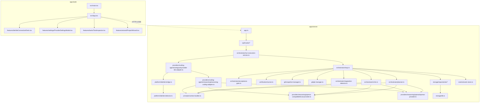

# Autonomous Development Orchestrator (`orches`)
## Architecture & Data Flow Reference

**Document Version:** 1.0.0  
**Audit Date:** October 11, 2026  
**Target Audience:** Claude Code / Engineering Handoff  

---

## 1. System Overview & Monorepo Structure

The Autonomous Development Orchestrator is structured as an npm workspaces monorepo containing three shared packages and two applications:

```
orches/
├── packages/
│   ├── shared-types/          # Canonical domain schemas, TypeScript interfaces, Zod models
│   ├── policy-schema/         # Policy rules, verification requirements, profile schemas
│   └── profile-presets/       # Standard autonomy presets (balanced, strict, creative)
├── apps/
│   ├── server/                # Fastify backend, SQLite persistence, execution loop, providers
│   └── web/                   # React 19 single-page dashboard, SSE consumer, Tailwind-free CSS
├── e2e/                       # Playwright browser end-to-end audit suites
└── artifacts/                 # Verification logs, screenshots, and run diagnostic evidence
```

---

## 2. High-Level Subsystem Architecture Diagram

```mermaid
flowchart TB
    subgraph Frontend["apps/web (React 19 SPA)"]
        UI[App.tsx Dashboard]
        SSE_Consumer[EventSource /api/v1/events]
        REST_Client[fetch /api/v1/*]
        IdeModal[IdeConnectionDeck.tsx]
        SettingsModal[ProviderSettingsModal.tsx]
    end

    subgraph Backend["apps/server (Fastify 5.2.1)"]
        Server[server.ts / app.ts]
        Router[API Routes: /runs, /projects, /providers, /ide, /events]
        ExecService[RunExecutionService.ts]
        Loop[AutonomousLoop.ts]
        Planner[PlannerService.ts]
        Critic[CriticService.ts]
        Gate[AcceptanceGate.ts]
        Stagnation[StagnationDetector.ts]
        VerifRunner[VerificationRunner.ts]
    end

    subgraph Storage["SQLite (Better-Sqlite3)"]
        DB[(orchestrator.db)]
        EventStore[EventStore.ts]
        Repo_Projects[ProjectRepository.ts]
        Repo_Runs[RunRepository.ts]
        Ledger[ReasoningUsageLedger.ts]
    end

    subgraph Providers["Reasoning Providers"]
        OllamaLocal[OpenAICompatibleLocalProvider (Ollama llama3.1:8b)]
        OpenAICloud[OpenAIProvider (gpt-4o / o1)]
        MockReason[MockProvider]
    end

    subgraph Adapters["Coding Agent Adapters"]
        VisAdapter[VisibleIdeAdapter.ts]
        ReasonAdapter[ReasoningCodingAgentAdapter.ts]
        AgyCliAdapter[AntigravityAdapter.ts]
        Bridge[IdeBridge.ts & IdeDetector.ts]
    end

    subgraph Safety["Workspace & Safety Management"]
        GitMgr[GitManager.ts (Branches/Commits/Diff)]
        SnapMgr[SnapshotManager.ts (Non-Git Local Hashing)]
        TargetWS[User Target Workspace Directory]
    end

    UI --> REST_Client
    UI --> SSE_Consumer
    REST_Client --> Router
    Router --> Server
    Server --> ExecService
    ExecService --> Loop
    Loop --> Planner
    Loop --> VisAdapter
    Loop --> VerifRunner
    Loop --> Critic
    Loop --> Gate
    Loop --> GitMgr
    Loop --> SnapMgr

    VisAdapter --> Bridge
    VisAdapter --> ReasonAdapter
    ReasonAdapter --> Providers
    Planner --> Providers
    Critic --> Providers

    VerifRunner --> TargetWS
    ReasonAdapter --> TargetWS
    SnapMgr --> TargetWS
    GitMgr --> TargetWS

    Loop --> DB
    Loop --> EventStore
    EventStore --> SSE_Consumer
```

---

## 3. Complete End-to-End Execution Lifecycle Trace

Below is the exact execution trace of a development run through the codebase from user click to final checkpoint commit:

```mermaid
sequenceDiagram
    autonumber
    actor User as Operator
    participant UI as React UI (App.tsx)
    participant API as Fastify API (/api/v1/runs)
    participant Exec as RunExecutionService
    participant Loop as AutonomousLoop
    participant Plan as PlannerService
    participant LLM as ReasoningProvider (Ollama/OpenAI)
    participant Agent as CodingAgentAdapter
    participant FS as User Workspace (Filesystem)
    participant Verif as VerificationRunner
    participant Critic as CriticService
    participant Gate as AcceptanceGate
    participant Snap as SnapshotManager / GitManager

    User->>UI: Click "Start Run" (#btn-start)
    UI->>API: POST /api/v1/runs { projectId }
    API->>Exec: startRun(projectId)
    Exec->>Snap: captureBaseSnapshot() / detect git status
    Exec->>Loop: runSingleTask() in background loop
    Loop->>Plan: planNextTask(project, roadmap)
    Plan->>LLM: generate({ operation: "task_planning", context })
    LLM-->>Plan: JSON Task Definition { id, title, criteria, verificationPlan }
    Loop->>Snap: createSafetyCheckpoint() (branch or local snapshot)
    Loop->>Agent: executeTask(task, workspacePath, context)
    
    alt In Visible IDE Mode
        Agent->>Agent: Verify IdeBridge connection & workspace match
        Agent->>LLM: Prompt model to output JSON file diffs
        LLM-->>Agent: JSON { files: [{ path, content }] }
        Agent->>FS: Write files directly to disk (sanitizing relative paths)
        Agent->>Verif: Run agent pre-claim checks
    end

    Agent-->>Loop: AgentReport { status, files_changed, summary }
    Loop->>Verif: runVerification(task.verificationPlan, workspacePath)
    Verif->>FS: Execute cmd.exe /c "npm test"
    FS-->>Verif: exitCode: 0, stdout, stderr
    Verif-->>Loop: VerificationResult[] { status: "passed", exitCode: 0 }
    Loop->>Snap: computeUnifiedDiff()
    Snap-->>Loop: diff string (actual changed lines)
    Loop->>Critic: reviewAttempt(task, diff, verifResults, agentReport)
    Critic->>LLM: generate({ operation: "result_review", diff, verifResults })
    LLM-->>Critic: CriticReview { verdict: "accept", criteria: [...] }
    Critic-->>Loop: Validated CriticReview
    Loop->>Gate: evaluate(task, attempt, criticReview, verifResults, diff)
    
    alt Verification Passed & Non-Metadata Files Present
        Gate-->>Loop: AcceptanceResult { decision: "accepted" }
        Loop->>Snap: commitCheckpoint(taskId, attemptId)
        Loop->>API: Emit event: task.completed
    else Check Failed or 0 User Files Changed
        Gate-->>Loop: AcceptanceResult { decision: "rejected", blockers }
        Loop->>Snap: rollbackAttempt(baseCommit)
        Loop->>Loop: Spawn repair attempt (bounded by maxAttempts)
    end

    API-->>UI: SSE Event Stream (task.completed, run.status)
    UI->>User: UI Updates Status Strip to "Ready" / Checkpoint saved
```

---

## 4. Subsystem Deep-Dives & Discrepancies

### 4.1 Reasoning Provider Subsystem
- **Expected Behavior:** An extensible provider abstraction supporting Local Ollama and OpenAI API, tracking token consumption and cost against user-configured budgets.
- **Actual Implementation:**
  - `ReasoningProvider` interface (`apps/server/src/providers/reasoning/provider.ts`).
  - `OpenAICompatibleLocalProvider` (`.../openai-compatible/local-provider.ts`): Normalizes Ollama URLs. Issues `GET /api/version` and `GET /api/tags` to server root (`127.0.0.1:11434`) for discovery, and `POST /v1/chat/completions` for OpenAI-compatible chat generation.
  - `OpenAIProvider` (`.../openai/openai-provider.ts`): Uses official `openai` Node SDK. Redacts keys, counts tokens, calculates estimated USD costs.
  - `ReasoningUsageLedger` (`apps/server/src/domain/budgets/usage-ledger.ts`): Persists every generation call into SQLite table `reasoning_usage_ledger`.
- **Operational Reality:** Confirmed functional at runtime. Probed live Ollama (`llama3.1:8b`) with 11ms latency and generated completions in 5.8s.

### 4.2 Coding Agent & Antigravity IDE Integration
- **Expected Behavior:** Autonomous dispatch to Antigravity IDE Agent through an editor extension or native CLI to make file edits.
- **Actual Implementation:**
  - `VisibleIdeAdapter` (`.../antigravity/visible-ide-adapter.ts`): Validates that an IDE window is open matching the canonical target workspace via `IdeDetector` and `IdeBridge`. It then **delegates file generation directly to `ReasoningCodingAgentAdapter`**, which prompts the active LLM (Ollama or OpenAI) and writes files using Node.js `fs.writeFileSync`.
  - `AntigravityAdapter` (`.../antigravity/antigravity-adapter.ts`): Looks for `agy` or `antigravity` CLI in PATH. Because the CLI is not installed on the host OS, it reports `installed: false`.
- **Discrepancy:** The "Visible IDE" integration does not send instructions to the internal Antigravity Agent. It is a synchronized reasoning coder that validates the IDE window is focused on the correct folder.

### 4.3 Workspace Safety, Snapshots & Rollback
- **Expected Behavior:** Safe file modifications in any local directory (Git or non-Git). Checkpoints and rollbacks without loss of unrelated user files.
- **Actual Implementation:**
  - `GitManager` (`apps/server/src/git/git-manager.ts`): Used when `.git` folder exists. Uses `git status --porcelain`, `git diff`, and creates branches `orchestrator/<projectId>/<taskId>/attempt-<num>`.
  - `SnapshotManager` (`apps/server/src/git/snapshot-manager.ts`): Used when `.git` is absent. Computes SHA-256 hashes of all non-orchestrator files, stores snapshots in `.orchestrator/snapshots/<id>/manifest.json`, generates unified diffs in memory, and performs selective rollbacks by deleting newly added files and restoring prior hashes.
- **Operational Reality:** Fully verified. Passed non-Git smoke test creating snapshot `snap-1791704057950-1e3c6650` in `os.tmpdir()`.

### 4.4 Verification & Command Execution
- **Expected Behavior:** Execution of test and build commands without shell injection vulnerabilities, supporting Windows environments.
- **Actual Implementation:**
  - `VerificationRunner` (`apps/server/src/verification/runner.ts`): Runs commands configured in `task.verificationPlan`.
  - Windows Process Invocation: Uses `process.env.ComSpec || "cmd.exe"` with arguments `["/d", "/s", "/c", cmdLine]`, `shell: false`, and `windowsVerbatimArguments: true`. Captures stdout, stderr, exit code, and enforces configurable timeouts (default 30s).
- **Operational Reality:** Completely eliminates Node.js `DEP0190` warnings. Accurately captured `node --test` exiting with code `0`.

### 4.5 Critic & Acceptance Gate
- **Expected Behavior:** An independent LLM evaluation of actual git diffs and test evidence before code is accepted.
- **Actual Implementation:**
  - `CriticService` (`apps/server/src/orchestrator/critic.ts`): Builds prompt containing actual diff, test exit codes, and output snippets. Prompts LLM for JSON verdict (`accept`, `repair`).
  - Deterministic Overrides:
    - If any mandatory check failed, verdict is forced to `repair`.
    - If all mandatory checks passed with exit code 0, diff is non-empty, and zero quality findings or scope drift are detected, verdict is forced to `accept` (preventing small LLM hallucinated rejections).
  - `AcceptanceGate` (`apps/server/src/orchestrator/acceptance-gate.ts`):
    - **Rule 0:** Requires at least one non-metadata file change outside `.orchestrator`.
    - Validates Critic verdict and verification violations.
    - If rejected, triggers rollback. If accepted, commits checkpoint.

---

## 5. File Relationship Dependency Map


